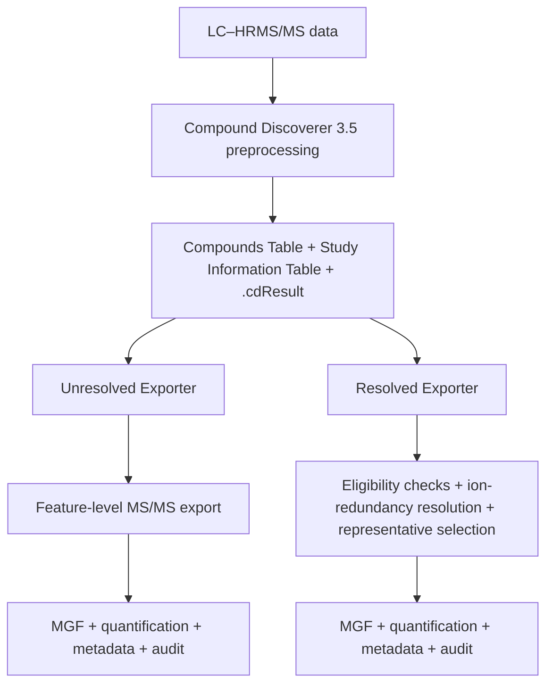

# CD-Ion-Resolver

**Python scripting nodes for ion-redundancy resolution and MS/MS spectral export from Thermo Scientific Compound Discoverer.**

Developed by the **CFR4 Research Group**, University of Modena and Reggio Emilia (UNIMORE), Italy.

CD-Ion-Resolver provides two complementary, independently executable Scripting Nodes for converting Compound Discoverer LC–HRMS/MS results into coordinated spectral, quantitative, metadata, and audit outputs. The **Unresolved Exporter** preserves the feature-level reference representation, while the **Resolved Exporter** applies ion-redundancy resolution and representative-feature selection before export.

## Overview



**Important:** The two nodes are **alternative processing routes**. They should be executed independently from the same Compound Discoverer results; they are not designed to run sequentially.

### Which node should I use?

| Node | Purpose | Main behavior |
| --- | --- | --- |
| **[Export to MGF – Unresolved](Export_mgf_unresolved/)** | Reference, feature-level export | Exports eligible MS/MS spectra and matched data without additional ion-redundancy resolution. |
| **[Export to MGF – Resolved](Export_mgf_resolved/)** | Compound-resolved export | Evaluates MS/MS eligibility, resolves related ion features, and selects a representative feature and spectrum for each resolved group before export. |

Both nodes generate coordinated outputs suitable for downstream MS/MS analyses and molecular networking, with an audit trail supporting traceability.

## Download

Download the installation archive from the **[Releases](https://github.com/CFR4-Research/CD-Ion-Resolver/releases)** section when a release is available. Each node is distributed in a separate folder containing its Python script, `node.json` configuration, and any referenced support files (including icons, where applicable).

The repository source archive (`Code` → `Download ZIP`) is also available, but a dedicated release archive is recommended for straightforward installation.

## Software requirements

The software environment used in the associated study was:

| Component | Version used in the study |
| --- | --- |
| Operating system | Microsoft Windows |
| Thermo Scientific Compound Discoverer | **3.5** |
| Python | **3.11.0** |
| pandas | **3.0.3** |
| openpyxl | **3.1.5** |

The scripts require a local Python installation. Other compatible versions may work but were not systematically evaluated in the study.

To reproduce the reported package environment, open **Command Prompt** and run:

```bat
python -m pip install pandas==3.0.3 openpyxl==3.1.5
```

If Python is not available through `PATH`, provide its full executable path, for example:

```bat
"C:\Program Files\Python311\python.exe" -m pip install pandas==3.0.3 openpyxl==3.1.5
```

The Python interpreter used to install the packages must be the same interpreter referenced by the corresponding `node.json` file.

## Installation in Compound Discoverer

### 1. Copy the node folders

Extract the downloaded release and copy both node folders into the default Scripting Nodes directory:

```text
C:\Program Files\Thermo\Compound Discoverer 3.5\Tools\Scripts
```

The resulting installation should resemble:

```text
C:\Program Files\Thermo\Compound Discoverer 3.5\Tools\Scripts\
├── Export_mgf_unresolved\
│   ├── cd_export_mgf_unresolved.py
│   ├── node.json
│   └── [any additional files referenced by node.json]
└── Export_mgf_resolved\
    ├── cd_export_mgf_resolved.py
    ├── node.json
    └── [any additional files referenced by node.json]
```

**Do not introduce an extra nested directory level** (for example, `Export_mgf_resolved/Export_mgf_resolved/`). Administrator privileges may be necessary to copy files into `Program Files`.

### 2. Verify paths in `node.json`

Open each node's `node.json` in a plain-text editor (such as Notepad++). Check two properties:

- **`ExecutablePath`** — the absolute path to the Python interpreter, for example `C:\Program Files\Python311\python.exe`.
- **`ExecutableCommandLineArguments`** — the absolute path to the corresponding `.py` script, followed by the original runtime placeholders **`%NODEARGS% %PARAMETERS%`**.

If Python or Compound Discoverer is installed in a different location, update the corresponding paths. In JSON, Windows directory separators must be written as **double backslashes (`\\`)**. Do **not** alter `%NODEARGS%` or `%PARAMETERS%`; Compound Discoverer uses them to pass the runtime parameters.

Ensure that the script filename, installed folder and `ExecutableCommandLineArguments` refer to the same file. Save the configuration without changing its `.json` extension.

### 3. Register the nodes

1. Start **Compound Discoverer 3.5**.
2. Go to **Help → License Manager**.
3. Select **Scan For Missing Features** to detect/register the Scripting Nodes.
4. Close and restart Compound Discoverer.

After restarting, **Export to MGF – Unresolved** and **Export to MGF – Resolved** should be available among the workflow nodes.

## Using the nodes

Both exporters are intended to operate downstream of Compound Discoverer preprocessing that generates the necessary **Compounds Table**, **Study Information Table**, and **`.cdResult`** file.

The `.cdResult` database is used to retrieve additional feature-level information, including ion-feature identifiers, ion-species assignments, corresponding MS/MS spectra, and (where available) precursor isolation-purity values.

- **Unresolved Exporter:** Produces a reference export of eligible entries with usable MS/MS spectra, without additional grouping based on coelution, ion relationships, MS/MS-child relationships, representative-ion reassignment, or isolation-purity filtering beyond the criteria described in the study.
- **Resolved Exporter:** Applies the defined MS/MS eligibility criteria (including isolation purity), evaluates coeluting features and ion relationships, constructs compound-resolved groups, and selects a representative ion feature and associated MS/MS spectrum for each group. Structural annotations alone are not used to merge chromatographically distinct features.

For a direct unresolved-versus-resolved comparison, run the exporters **separately on the same preprocessed dataset**.

## Output files

Each execution writes coordinated files to the user-defined output directory:

| Output | Contents |
| --- | --- |
| **MGF** | Exported MS/MS spectra |
| **Quantitative table** | Abundance/quantification data matched to the exported entries |
| **Metadata** | Experimental and feature-associated metadata |
| **Audit workbook** | Exported entries, exclusions, and traceability information |

Shared identifiers help preserve correspondence between spectra and quantitative information.

## Troubleshooting

If a node is missing from the Compound Discoverer workflow node list or fails to execute:

1. Check that the node folders are directly under `Tools\Scripts` and contain their `node.json` files.
2. Verify the paths in `ExecutablePath` and `ExecutableCommandLineArguments`.
3. Confirm that the referenced Python executable exists and has `pandas` and `openpyxl` installed.
4. Check that all support files referenced by `node.json` (such as icon files) are present.
5. Repeat **Help → License Manager → Scan For Missing Features**, then restart Compound Discoverer.

## Reproducibility and citation

For reproducibility, record the **CD-Ion-Resolver release/tag**, **Compound Discoverer version**, **Python version**, and **package versions** used for each analysis.

**Associated manuscript:** citation and DOI will be added when the paper is published.

## License

License information will be added before public distribution, following the applicable institutional requirements.

